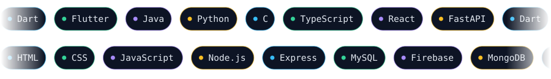

  

<h2><code>~/about</code></h2>

<pre>
{
  "name": "Guha Bava Jaya Sre A",
  "alias": "GBJS",
  "location": "Tiruchirappalli, Tamil Nadu, India",
  "studying": "B.Tech Information Technology (class of 2028)",
  "building": [
    "Smart Accident Detection &amp; Emergency Alerting (IoT)",
    "InternWorth (NLP internship scorer)"
  ],
  "leadership": [
    "Secretary, EVS Club",
    "Senior Office Bearer, Mystik (IT Dept. Association)"
  ],
  "openTo": "internships &amp; entry-level dev roles",
  "linkedin": "linkedin.com/in/gbjs22"
}
</pre>

<h2><code>~/stack</code></h2>

  

<h2><code>~/projects</code></h2>

  

<h2><code>~/connect</code></h2>

  
  &nbsp;
  
    
  <code>// let's build something together</code>

<h2><code>~/stats</code></h2>

  

